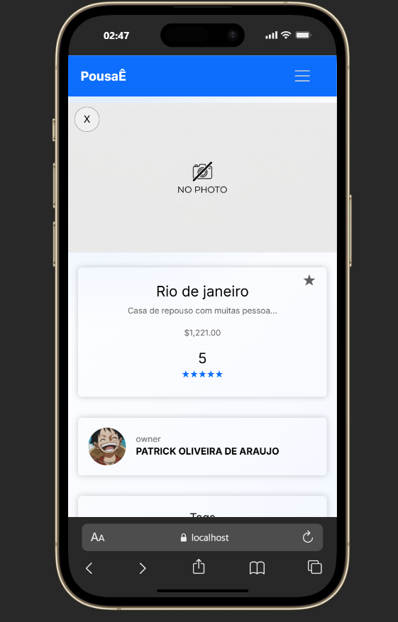
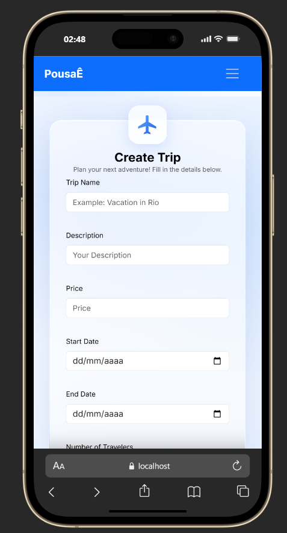
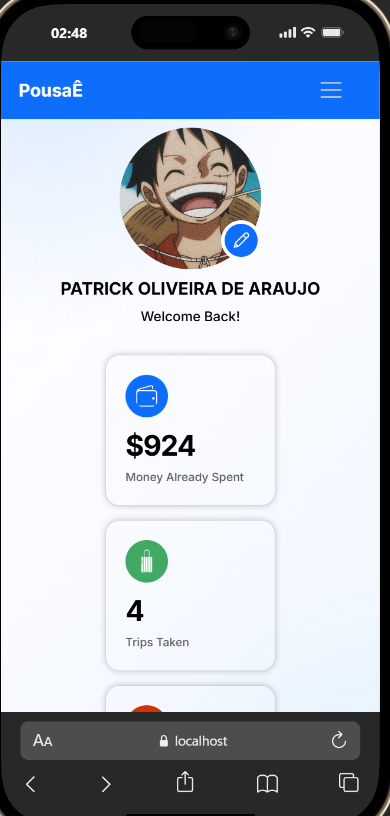
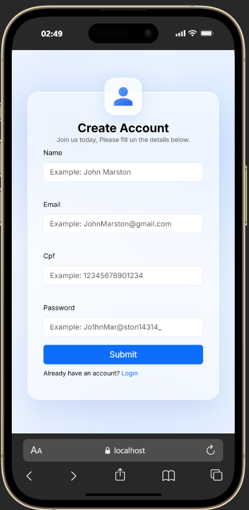
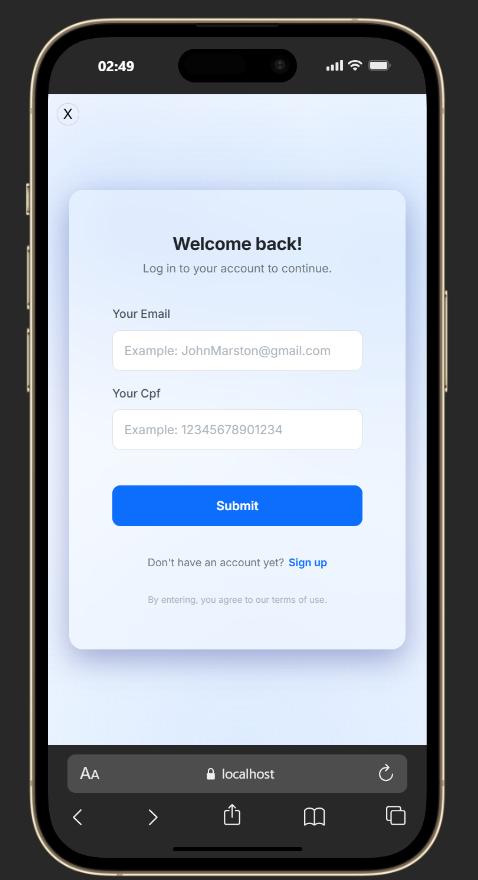

# 🏨 PousaE

> A modern platform to discover, book, and manage memorable travel experiences.

Pousa is a full-stack travel platform developed independently, built with React on the frontend and FastAPI on the backend, using PostgreSQL for data persistence. It allows users to explore trips, manage their profiles, save favorites, purchase trips, review experiences, and interact with an AI assistant.

---

<div align="center">


<p>
  
</p>

</div>

---

## 📊 Project Status

| Aspect | Status |
|---|---:|
| **Overall Rating** | 8.0 / 10 ⭐ |
| **Frontend** | ✅ Functional |
| **Backend** | ✅ Operational |
| **Database** | ✅ PostgreSQL configured |
| **Deployment** | ✅ Vercel (frontend) |
| **Development** | 👤 Independently maintained |

> The rating is a qualitative project assessment, not a benchmark or production-readiness certification.

---

## 🧩 Tech Stack

- **Frontend:** React, Vite, JavaScript, HTML, CSS, Bootstrap
- **Backend:** Python, FastAPI, Pydantic
- **Database:** PostgreSQL with `psycopg2`
- **Authentication:** HTTP-only cookies + UUID session tokens
- **AI integration:** Gemini for chatbot and content moderation
- **Image hosting:** ImgBB
- **Deployment:** Vercel

---

## ✨ Main Features

- User registration and login with email validation, CPF validation, and secure password handling
- Session management using HTTP-only cookies
- User profile with avatar, balance, and trip history
- Trip listing, search, and filtering
- Detailed trip pages with dates, pricing, traveler limits, and pet policy
- Purchase flow with balance verification and self-purchase protection
- Favorites system for saving preferred trips
- Reviews and ratings with moderation powered by Gemini
- AI virtual assistant for user support and recommendations
- User history and trip-related information

---

## 🔐 Security and Best Practices

- Passwords are hashed with Argon2
- Cookies use `HttpOnly` and `Secure` in production, with `SameSite` configuration
- IP-based rate limiting is configured on the backend
- CORS is configured for the frontend origins
- Input validation is handled with Pydantic and backend validation
- Automated moderation helps detect and filter inappropriate content

> Security controls are continuously evolving. The project should not be considered security-audited or production-ready for real financial transactions.

---

## 🔌 API Overview

### Users
```bash
POST   /registerUser    - Register a new user
POST   /login           - Authenticate a user
GET    /checkUser       - Verify the current session
GET    /getUser         - Get the authenticated user's data
POST   /upload-image    - Upload a profile image
```

### Trips and Purchases
```bash
POST   /trips           - Create a new trip
GET    /getTrips        - List trips
POST   /buyTrip         - Purchase a trip
POST   /addStar         - Add a trip to favorites
POST   /removeStar      - Remove a trip from favorites
GET    /getStar         - List favorite trips
```

### Reviews and AI
```bash
POST   /createComment   - Create a review/comment (moderated)
POST   /getComment      - Retrieve comments
POST   /chatbot         - Chat with the AI assistant
```

---

## 🏗️ Architecture

```text
Frontend (React + Vite)
  - Components: Home, Trips, Dashboard
  - Styling: Bootstrap + Custom CSS
          |
          | REST API
          v
Backend (FastAPI + Python)
  - Routers: Users, Trips, Comments, Chatbot
  - Middleware: CORS, Rate Limiting
          |
          v
Database (PostgreSQL)
```

---

## 📂 Repository Structure

```text
Pousa-/
├── API/
│   ├── Databases/
│   ├── Routers/
│   ├── SQL/
│   ├── Validation/
│   ├── main.py
│   └── requirements.txt
├── public/
├── previews/              # Project screenshots and visual assets
├── src/
│   ├── App.jsx
│   ├── main.jsx
│   ├── Components/
│   ├── StylesGlobals/
│   └── assets/
├── .env.example
├── .gitignore
├── .oxlintrc.json
├── index.html
├── package.json
├── pnpm-lock.yaml
├── vite.config.js
├── vercel.json
├── CONTRIBUTING.md
└── README.md
```

---

## 📸 Screenshots

<details>
  <summary>Click to view project images</summary>

### Home and trip discovery


### Trip details


### User dashboard


### Booking interface


### Favorites and reviews


### User profile


### Trip history


### AI chat assistant


</details>

---

## 🗄️ Database Summary

### Users (`usersPousae`)
```sql
id SERIAL PRIMARY KEY
name VARCHAR(150) NOT NULL
email VARCHAR(254) NOT NULL
password VARCHAR(255) NOT NULL -- Argon2 hashed
session_token UUID UNIQUE
cpf VARCHAR(14)
money NUMERIC(10,2) DEFAULT 1000.00
image_url TEXT
moneyalreadyspent NUMERIC(10,2) DEFAULT 0.0
tripsTaken INTEGER DEFAULT 0
star INT[]
comments INT[]
```

### Trips
```sql
id SERIAL PRIMARY KEY
name VARCHAR NOT NULL
description TEXT NOT NULL
startDate DATE NOT NULL
endDate DATE NOT NULL
numberOfTravelers INT NOT NULL
petsAllowed BOOLEAN
price NUMERIC(10,2) NOT NULL
session_token UUID -- owner
review FLOAT DEFAULT 0
usersPurchased UUID[]
comments TEXT[]
usersComments UUID[]
notes INT[]
```

---

## 🚀 Run Locally

### Prerequisites

- Node.js 18+
- pnpm
- Python 3.10+
- PostgreSQL

### Quick Start

1. Clone the repository:
```bash
git clone https://github.com/joaopedro236/Pousa-.git
cd Pousa-
```

2. Start the frontend:
```bash
pnpm install
pnpm dev
# app: http://localhost:5173
```

3. Start the backend:
```bash
cd API
python -m venv .venv

# Windows
.venv\Scripts\activate

# macOS/Linux
source .venv/bin/activate

pip install -r requirements.txt
uvicorn main:app --reload
# API docs: http://localhost:8000/docs
```

4. Configure the database:
- Use `.env.example` as a reference
- Create the required PostgreSQL databases
- Configure the environment variables before starting the backend

---

## 🔧 Environment Variables

```env
DB_HOST=localhost
DB_PORT=5432
DB_NAME=pousa_users
DB_USER=postgres
DB_PASSWORD=your_password

DB_HOST_TRIP=localhost
DB_PORT_TRIP=5432
DB_NAME_TRIP=pousa_trips
DB_USER_TRIP=postgres
DB_PASSWORD_TRIP=your_password

VITE_API_URL=http://localhost:8000
FRONTEND_URLS=http://localhost:5173,http://localhost:3000
IMGBB_URL=your_imgbb_key
GEMINI_API_KEY=your_gemini_key
```

---

## 📦 Frontend Scripts

```bash
pnpm dev       # Start the development server
pnpm build     # Build for production
pnpm preview   # Preview the production build
pnpm lint      # Run the linter
```

---

## 📈 Project Notes

- **Rate limit:** 30 requests/second per IP (configured limit)
- **Session expiry:** 7 days
- **Upload limit:** 5 MB (JPG, PNG, WEBP)
- **Maintenance:** Developed and maintained independently

---

## 🛠️ Troubleshooting

- **Port 5173 already in use:** `pnpm dev -- --port 3000`
- **Module errors:** reinstall dependencies with `pnpm install`
- **Database connection issues:** Check your `.env` values and ensure PostgreSQL is running
- **Gemini API errors:** Verify your API key and request format

---

## 📄 License

MIT

---

## 📞 Contact

- **Issues:** https://github.com/joaopedro236/Pousa-/issues
- **Live Demo:** https://pousa.vercel.app

---

## 👨‍💻 Author

**João Pedro Oliveira** — https://github.com/joaopedro236

---

<p align="center">Made with ❤️ using React, FastAPI, and PostgreSQL</p>
